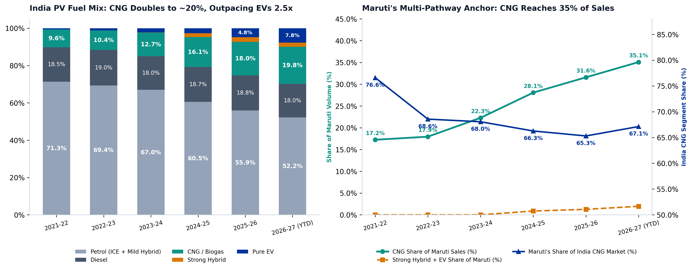
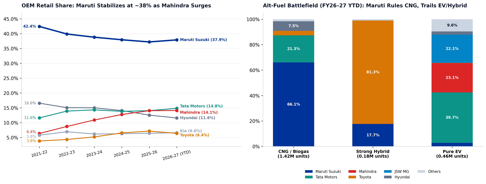
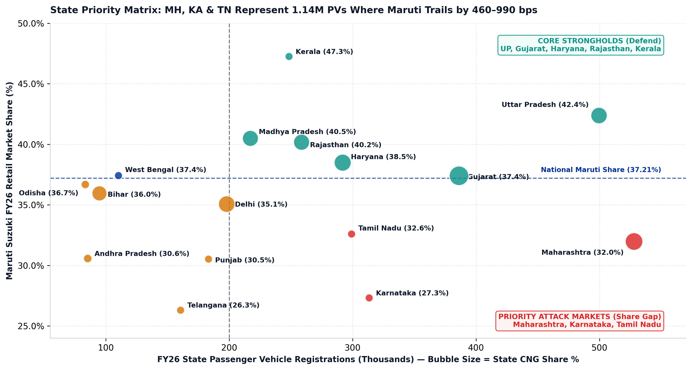
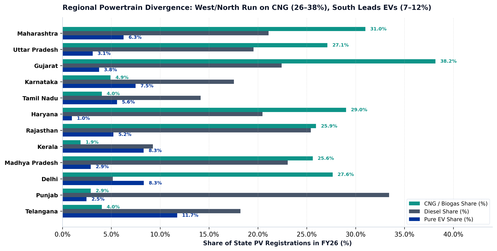

# India Passenger Vehicle Market & Powertrain Strategy Analysis (FY22–FY27 YTD)

An empirical market research, powertrain transition, and regional sales-strategy analysis of India's Passenger Vehicle (PV) market, built on **22.04 million** official MoRTH VAHAN retail registrations across **36 States/UTs** and **6 Financial Years (FY22–FY27 YTD)**.

---

## Executive Deliverables
* **Executive Brief (PDF):** [India_PV_Market_Strategic_Brief.pdf](./India_PV_Market_Strategic_Brief.pdf)
* **Strategy Presentation (PDF — Browser View):** [India_Passenger_Vehicle_Market_Strategy.pdf](./India_Passenger_Vehicle_Market_Strategy.pdf) | [Download PPTX](./India_Passenger_Vehicle_Market_Strategy.pptx)
* **Cleaned Master Datasets & Raw VAHAN Data:** [`data/`](./data)
* **Python ETL & Visualization Pipeline:** [`suzuki_market_research_project.py`](./scripts/suzuki_market_research_project.py)

---

## Key Strategic Findings

1. **Multi-Pathway Transition Validated by Mass-Market Data:**
   * Pure/mild-hybrid **Petrol** declined **1,914 bps** nationally (`71.34%` in FY22 → `52.20%` in FY27 YTD), while **Diesel** held flat at `18.0%–19.0%`.
   * **CNG/Biogas** more than doubled (`9.55%` → `19.81%`), remaining **2.5× larger than Pure EVs (`7.77%`)** in mass-market PVs.
2. **Maruti Suzuki's Core Defense vs. Competitive White Spaces:**
   * Maruti Suzuki stabilized retail market share at **37.90%** in FY27 YTD (`+69 bps` vs. FY26's `37.21%`), anchored by **45.71%** Petrol share and **67.12%** CNG category dominance (CNG now represents **35.08%** of Maruti's internal volume).
   * **Primary Gaps:** Across FY26–FY27 YTD, Maruti held **2.79%** of Pure EVs (vs. Tata `39.66%`, Mahindra `23.13%`, JSW MG `22.14%`) and **17.70%** of Strong Hybrids (vs. Toyota `81.28%`).
   * **Competitive Shift:** Mahindra more than doubled its national PV share (`6.4%` → `14.1%`), overtaking Hyundai (`11.6%`) to challenge Tata Motors (`14.8%`) for #2.
3. **Regional Sales Planning Playbook (1.14M-Unit Priority Attack Zone):**
   * **Priority Attack Markets (`Maharashtra`, `Karnataka`, `Tamil Nadu`):** Combined **11.40 lakh** PVs in FY26 where Maruti trails its national share by **460–990 bps** (`MH: 32.0%`, `TN: 32.6%`, `KA: 27.3%`).
   * **Core Strongholds (`UP`, `Gujarat`, `Haryana`, `Rajasthan`, `Kerala`):** Defend via dedicated CNG/CBG supply in North/West (`26–38%` CNG share) and Strong Hybrid expansion in Kerala (`47.3%` Maruti share, `8.3%` EV).

---

## Visual Summary

### 1. India Powertrain Transition & Maruti's CNG Engine


### 2. OEM Market Share Trajectory & Alt-Fuel Battlefield


### 3. State Strategic Priority Matrix (FY26 Volume vs. Maruti Share)


### 4. Regional Powertrain Divergence (Top 12 States, FY26)


---

## Methodology & Data Integrity

* **Primary Dataset (100% of Charts & Master Tables):** 18 MoRTH VAHAN public registration exports (`Maker × State`, `State × Fuel`, and `Maker × Fuel` for `Class = MOTOR CAR`, FY22–FY27 YTD), cross-reconciled to the exact single vehicle (**22,042,706** total registrations, zero discrepancy across tables).
* **Entity Consolidation:** Merged fragmented legal registration entities into parent OEM groups (e.g., `Tata Motors PV` + `Tata Passenger Electric Mobility` + `Tata Motors Ltd` → `Tata Motors`; `MG Motor` + `JSW MG` → `JSW MG`; `Mahindra & Mahindra` + `Mahindra Electric` → `Mahindra`).
* **Powertrain Standardization:** Mapped 34 granular VAHAN fuel tags into 5 business categories (`Petrol`, `Diesel`, `CNG/Biogas`, `Strong Hybrid`, `Pure EV`), classifying mild hybrids under `Petrol` per industry convention.
* **Macro Context Overlay (Executive Brief & Deck):** Referenced public **SIAM Q2 FY27** wholesale releases (`1.36M` PVs, `68%` UV share) and **FADA Oct 2026** retail releases (`43–45 days` PV dealer inventory vs. `21-day` benchmark) to contextualize body-style shifts and channel health.

---

## Repository Structure

```text
├── charts/
│   ├── chart1_powertrain_transition.png
│   ├── chart2_oem_competitive_battlefield.png
│   ├── chart3_state_priority_matrix.png
│   └── chart4_state_powertrain_divergence.png
├── data/
│   ├── Suzuki_India_PV_OEM_Yearly_Master.csv
│   ├── Suzuki_India_PV_State_Fuel_Panel.csv
│   ├── Suzuki_India_PV_State_Strategic_Matrix.csv
│   └── [18 Raw MoRTH VAHAN CSV Exports (FY22–FY27 YTD)]
├── scripts/
│   ├── Suzuki_Market_research_Project.ipynb
│   └── suzuki_market_research_project.py
├── India_PV_Market_Strategic_Brief.pdf
├── India_Passenger_Vehicle_Market_Strategy.pdf
├── India_Passenger_Vehicle_Market_Strategy.pptx
└── README.md
